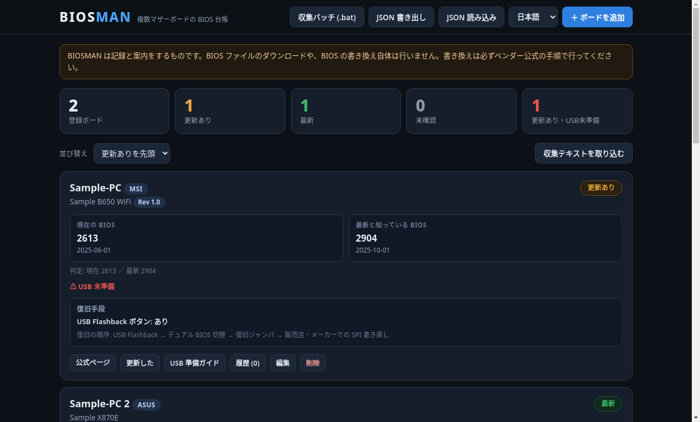

# BIOSMAN

A ledger app for managing and updating the BIOS of multiple PC motherboards: which board is in which machine, which BIOS version it runs, whether a newer one exists, and when you updated it — all in one place.

複数台の PC マザーボードについて、「どのマシンに・どのボードが・どの BIOS バージョンで載っていて・最新版が出ているか・いつ更新したか」を一元管理する台帳アプリです。



## Download / 入手方法

Get the latest build from [Releases](../../releases):

- **`BIOSMAN-Windows.zip`** — the executable edition for Windows. Unzip it and run `BIOSMAN.exe`; no installer, nothing written to the registry. This edition can also scan your USB drives for BIOS files and notify you about newer versions (see below).
- **`index.html`** — the browser edition. A single file; just open it in a browser. No install, works on any OS, works offline, loads no external libraries or fonts.

Releases から最新版を入手してください。`BIOSMAN-Windows.zip` は Windows 向け実行ファイル版（展開して `BIOSMAN.exe` を起動するだけ、インストーラーなし・レジストリ書き込みなし）、`index.html` はブラウザ版（ファイル1つをブラウザで開くだけ、全 OS・オフライン可）です。

## What it does / できること

- **Board ledger with status** — Register each machine's vendor, model, and current BIOS version. BIOSMAN compares it with the latest version you know of and shows the status ("update available" / "up to date" / "unknown"), always displaying both versions the judgement is based on. Version comparison is a natural-order approximation (numbers and letters compared separately).
  **ボード台帳と状態判定** — マシンごとにベンダー・モデル・現在の BIOS バージョンを登録すると、最新と知っているバージョンと比較して状態を自動判定します。判定に使った両バージョンは常に画面に表示されます。
- **Update history with a safety checklist** — Recording an update requires completing a safety checklist first (exact model and revision match, stable power, BitLocker recovery key saved and protection suspended, current BIOS settings recorded, optimized defaults loaded with tuning cleared, file obtained from the official page, never power off mid-flash). Each completed update is kept in the board's history.
  **更新履歴と安全チェックリスト** — 更新の記録は、書き換え前の安全確認（型番とリビジョンの完全一致、電源の安定、BitLocker 回復キーの控えと保護の一時停止、BIOS 設定の記録、最適化デフォルトの読み込みとチューニングの解除、公式ページからの入手、書き換え中に電源を切らない）を全て終えるまで確定できません。更新はボードごとの履歴に残ります。
- **Board revision and recovery record** — The board revision (the Rev printed on the PCB) is a separate registry field, because boards with the same model name but a different revision may need different BIOS files. You can also record each board's recovery options — whether it has a USB Flashback button, whether it has dual BIOS, and free-form recovery notes (which port, where the jumper is, the steps) — so the recovery ladder (Flashback → dual-BIOS switch → recovery jumper → SPI reflash at a shop) is at hand in an emergency. The update flow, the USB preparation guide, and the help section all warn that progress may look stuck at 99% and that a black screen right after reboot (memory training, 30 seconds to 2 minutes) is normal — never cut the power in a panic.
  **基板リビジョンと復旧手段の記録** — 基板に印字されたリビジョン（Rev）をモデル名とは別の台帳項目として記録できます（同じモデル名でもリビジョン違いで BIOS ファイルが異なるため）。あわせてボードごとの復旧手段（USB Flashback ボタンの有無、デュアル BIOS の有無、専用ポートや復旧ジャンパの場所・手順のメモ）を記録でき、事故時に復旧の順序をボードのカードからすぐ確認できます。更新フロー・USB 準備ガイド・ヘルプには「進捗が 99% で止まって見えても触らないこと、再起動直後の黒画面（メモリートレーニング）は正常であること」を明記しています。
- **USB stick ledger and preparation guide** — BIOS updates usually go through a FAT32 USB stick, and with several boards it is easy to lose track of which stick holds which board's file. Register your sticks (name, capacity, FAT32 or not, assigned board, BIOS file name and version on it, prepared date). BIOSMAN shows whether a stick is ready (its version matches the board's latest) or stale, and flags boards that have an update but no ready stick. A per-vendor preparation guide shows the file naming rules (for example MSI Flash BIOS Button: rename to `MSI.ROM`; GIGABYTE Q-Flash Plus: `GIGABYTE.bin`; ASRock BIOS Flashback: `PSPBIOS.IMG`; ASUS USB BIOS Flashback: the name produced by BIOSRenamer) plus the common steps — always confirm the final details in your motherboard's manual.
  **USB 台帳と準備ガイド** — どの USB に・どのボード用の・どのバージョンのファイルが入っているかを台帳で管理し、「準備OK」「古い（作り直し）」「USB 未準備」を自動判定します。ベンダーごとのファイル命名規則と準備手順のガイド付き（最終確認は必ずマザーボードのマニュアルで）。
- **USB scan and new-version notification (executable edition)** — The Windows executable can actually look inside the USB drives connected to your PC, list the BIOS files it finds, and match them against your ledger. If it finds a version newer than what a board currently runs, it notifies you. It can also check the official download pages you registered and present newer versions it finds there as *candidates*.
  **USB 実走査と新しい版数の通知（実行ファイル版）** — PC に挿さっている USB を実際に読み取り、BIOS ファイルをリスト化して台帳と照合します。現在のバージョンより新しいものがあれば通知します。登録済みの公式ダウンロードページを確認し、新しい版数の候補を提示することもできます。
- **Automatic latest-version fetch for ASUS boards (executable edition)** — For ASUS boards, the version check queries ASUS's official support API by model name — no page URL needs to be registered — and reads the latest BIOS version and its release date from the structured response. The fetched version, the fetch date/time, and the source URL are recorded in the ledger and shown on the board's card, whether or not a newer version was found. If the check fails (for example, the model name does not match the official spelling), the reason is shown and nothing is recorded. Automatic fetching currently covers **ASUS only**; other vendors use the registered-page check or manual entry.
  **ASUS ボードの最新版自動取得（実行ファイル版）** — ASUS のボードについては、モデル名で ASUS の公式サポート API に問い合わせ、構造化データから最新の BIOS バージョンと公開日を取得します（ページ URL の登録は不要です）。取得した版数・取得日時・取得元 URL は、新しい版数があってもなくても台帳に記録され、ボードのカードに表示されます。取得できない場合（モデル名が公式の表記と違う等）は理由を表示し、記録はしません。自動取得の対応は現在 **ASUS のみ** で、それ以外のベンダーは登録済みページの確認か手入力です。
- **Collect your PC's info easily** — In the Windows app built from this source, **Import PC info → Read this PC** fills the registration form with the local motherboard and BIOS details for review before saving. To import in the browser or from another Windows PC, run `biosman-collect.bat` on that PC and paste the resulting text into BIOSMAN.
  **情報収集の取り込み** — このソースから起動した Windows アプリでは「PC 情報を取り込む → この PC の情報を読み取る」で、使用中の PC のマザーボード（基板リビジョンを含む）と BIOS の情報が登録フォームに入り、保存前に確認できます。ブラウザ版や別の Windows PC の情報を取り込む場合は、対象 PC で `biosman-collect.bat` を実行し、収集テキストを貼り付けます。

Supported vendors: ASUS / MSI / GIGABYTE / ASRock / Biostar / others. Links to each vendor's official download center are built in, and you can also register the official support page URL per board.

対応ベンダー: ASUS / MSI / GIGABYTE / ASRock / Biostar / その他。各社の公式ダウンロードセンターへのリンクをアプリ内に用意しています（ボードごとに、そのモデルの公式サポートページ URL も登録できます）。

## Honest scope / 正直な範囲

**BIOSMAN records, guides, and detects. It does not download BIOS files for you, and it never flashes a BIOS.** Flashing must always be done with the file from the vendor's official page, following the vendor's official procedure. Newer versions found on official pages or via the official ASUS API are shown as candidates only — nothing is treated as "the latest" until you confirm and record it yourself. The fetch itself only ever reads version information (a small JSON response); it never downloads a BIOS file.

**BIOSMAN は記録と案内と検出をするものです。BIOS ファイルのダウンロードや、BIOS の書き換え自体は行いません。** 書き換えは必ず各ベンダーの公式ページから入手したファイルで、公式手順で行ってください。公式ページや ASUS 公式 API で見つかった新しい版数は「候補」として提示するだけで、あなたが確認して記録するまで最新としては扱いません。取得処理が読み取るのは版数情報（小さな JSON 応答）だけで、BIOS ファイル自体をダウンロードすることはありません。

## Your data / データについて

All data stays on your own device. The browser edition stores it in the browser's `localStorage` (key: `biosman-v1`); the executable edition stores it under `%APPDATA%\BIOSMAN`. Nothing is sent to the author or to any server — the author holds no user data. Use the JSON export/import to back up your ledger or move it between devices.

データはあなたの端末の中だけに保存されます（ブラウザ版は `localStorage`、実行ファイル版は `%APPDATA%\BIOSMAN`）。作成者側のサーバー等に送られることはなく、作成者はデータを持ちません。バックアップや端末間の移行には JSON 書き出し／読み込みを使ってください。

## Run from source / ソースからの実行

- Browser edition: open `index.html` in a browser — that single file is the whole app.
- Executable edition (development): the Electron wrapper (`electron/main.js`) loads `index.html` from its own folder, so copy the app file next to it first, then start it with [Electron](https://www.electronjs.org/):

  ```
  cp index.html electron/
  cd electron
  npx electron .
  ```

ブラウザ版は `index.html` を開くだけでアプリ本体そのものです。実行ファイル版の開発用起動は、ラッパーが同じフォルダの `index.html` を読み込む作りのため、まず `index.html` を `electron/` にコピーしてから Electron で起動します。

Logic tests (version comparison, page extraction, the ASUS API response parser — against a trimmed real capture in `tests/fixtures/`) run with plain Node, no dependencies: `node tests/run-tests.js`.

ロジックのテスト（版数比較、ページ抽出、ASUS API 応答の解析。実応答を切り詰めたフィクスチャ使用）は依存なしの Node で実行できます: `node tests/run-tests.js`

## License / ライセンス

MIT — see [LICENSE](LICENSE).
